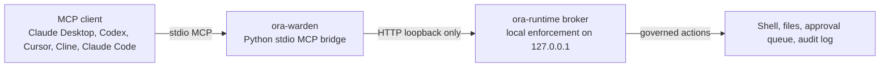

# ORA Warden

[](https://pypi.org/project/ora-warden/)
[](https://pypi.org/project/ora-warden/)
[](LICENSE)

**A fail-closed MCP server for local AI agents. Your agent does the work; you keep the keys.**

ORA Warden gives MCP clients a governed shell, governed file read/write, a human approval queue,
and a tamper-evident audit log. Destructive commands, secret paths, and off-box exfiltration are
blocked by the local broker by default. Human-authorized actions require an operator token and fail
closed without it.

ORA Warden is local-first and loopback-only. It is a leash for one developer's agent, not an
enterprise MCP gateway or cloud control plane.

> ORA Warden is the free, Apache-2.0 core of [ORA](https://ora.3d3d.ca). The paid ORA operator is a
> separate product and is not included in this repository.

## How it works



This package is the thin MCP bridge. The actual enforcement lives in the separate local broker
binary, `ora-runtime`, launched directly or through `ora-warden-broker`. If the broker is down,
blocks a request, or returns `403`/`409`, ORA Warden surfaces that as a blocked/fail-closed result.

## Tools

| Tool | What it does |
| --- | --- |
| `shell` | Runs a shell command through the governed, audited broker. |
| `shell_destructive` | Runs a deliberately destructive command only with an operator token. |
| `read_file` / `write_file` | Reads or writes local files through approved-path and secret-path policy. |
| `propose` | Queues an impactful action for human review instead of doing it directly. |
| `queue` / `proposals_list` / `proposal_get` | Inspects the approval queue. |
| `proposal_approve` / `proposal_reject` / `proposal_execute` | Operator-token gated proposal disposition. |
| `audit_verify` / `audit_sth` / `audit_recent` | Verifies and inspects the tamper-evident audit log. |
| `health` | Checks broker and approval queue liveness. |

Expected registered tool count: 15.

## Install

Install the MCP bridge from PyPI:

```bash
uvx ora-warden
```

Or install it persistently:

```bash
pipx install ora-warden
```

Install the broker separately. ORA Warden expects the `ora-runtime` broker binary on `PATH`, or at
the path in `ORA_WARDEN_BROKER_BIN`.

```bash
export ORA_WARDEN_BROKER_BIN=/path/to/ora-runtime
ora-warden-broker
```

The launcher starts the broker on `127.0.0.1:4573` by default, creates per-user state under
`$XDG_DATA_HOME/ora-warden/runtime` or `~/.local/share/ora-warden/runtime`, and points the broker at
the packaged default constitution. The broker remains the enforcement boundary.

## Client setup

Start the broker first:

```bash
ora-warden-broker
```

Then register the MCP bridge with your client.

### Claude Desktop

Claude Desktop now supports Desktop Extensions for local MCP servers. If installing manually, add a
stdio server entry to `claude_desktop_config.json` and restart Claude Desktop:

```json
{
  "mcpServers": {
    "ora-warden": {
      "type": "stdio",
      "command": "uvx",
      "args": ["ora-warden"],
      "env": {
        "ORA_BROKER_URL": "http://127.0.0.1:4573",
        "ORA_OPERATOR_URL": "http://127.0.0.1:5577"
      }
    }
  }
}
```

### Codex

Codex uses `~/.codex/config.toml` or trusted project-scoped `.codex/config.toml`:

```toml
[mcp_servers.ora-warden]
command = "uvx"
args = ["ora-warden"]
startup_timeout_sec = 20
tool_timeout_sec = 180

[mcp_servers.ora-warden.env]
ORA_BROKER_URL = "http://127.0.0.1:4573"
ORA_OPERATOR_URL = "http://127.0.0.1:5577"
```

### Cursor

Use Cursor Settings -> Tools & MCP -> New MCP Server, or create `.cursor/mcp.json` in a project or
`~/.cursor/mcp.json` globally:

```json
{
  "mcpServers": {
    "ora-warden": {
      "type": "stdio",
      "command": "uvx",
      "args": ["ora-warden"],
      "env": {
        "ORA_BROKER_URL": "http://127.0.0.1:4573",
        "ORA_OPERATOR_URL": "http://127.0.0.1:5577"
      }
    }
  }
}
```

### Cline

Cline uses `~/.cline/mcp.json` for CLI and opens its MCP settings JSON from the extension UI:

```json
{
  "mcpServers": {
    "ora-warden": {
      "type": "stdio",
      "command": "uvx",
      "args": ["ora-warden"],
      "env": {
        "ORA_BROKER_URL": "http://127.0.0.1:4573",
        "ORA_OPERATOR_URL": "http://127.0.0.1:5577"
      }
    }
  }
}
```

### Claude Code

For a local/user-scoped server:

```bash
claude mcp add --scope user --transport stdio ora-warden -- uvx ora-warden
```

For a project-scoped `.mcp.json`:

```json
{
  "mcpServers": {
    "ora-warden": {
      "type": "stdio",
      "command": "uvx",
      "args": ["ora-warden"],
      "env": {
        "ORA_BROKER_URL": "http://127.0.0.1:4573",
        "ORA_OPERATOR_URL": "http://127.0.0.1:5577"
      }
    }
  }
}
```

More complete examples live in [`examples/`](examples/).

## Configuration

| Environment variable | Default | Purpose |
| --- | --- | --- |
| `ORA_BROKER_URL` | `http://127.0.0.1:4573` | Loopback URL for shell/file/audit broker calls. |
| `ORA_OPERATOR_URL` | `http://127.0.0.1:5577` | Loopback URL for the approval queue. |
| `ORA_DEFAULT_CWD` | `~` | Default working directory for `shell` calls. |
| `ORA_DEFAULT_AUTHORITY` | `A3` | Default authority level sent to the broker. |
| `ORA_HTTP_TIMEOUT` | `180` | HTTP timeout in seconds for broker calls. |
| `ORA_WARDEN_TOKEN_FILE` | `$XDG_CONFIG_HOME/ora-warden/operator-token.env` | Token file for gated actions. |
| `ORA_OPERATOR_TOKEN` | unset | Operator token for gated actions; env takes precedence over file. |
| `ORA_WARDEN_BROKER_BIN` | `ora-runtime` | Broker binary path used by `ora-warden-broker`. |
| `ORA_WARDEN_HOST` | `127.0.0.1` | Broker host used by `ora-warden-broker`. |
| `ORA_WARDEN_PORT` | `4573` | Broker port used by `ora-warden-broker`. |
| `ORA_RUNTIME_ROOT` | `$XDG_DATA_HOME/ora-warden/runtime` | Broker state/audit root used by the launcher. |
| `ORA_CONSTITUTION_PATH` | packaged default constitution | Broker constitution path used by the launcher. |

Token file format:

```bash
ORA_OPERATOR_TOKEN=your-local-operator-token
```

The token is never returned by tools. Missing-token gated actions return a blocked/fail-closed
message.

## Security model

ORA Warden is designed around conservative failure:

| Control | Behavior |
| --- | --- |
| Destructive commands | Ordinary `shell` calls are broker-screened; destructive intent requires `shell_destructive` and an operator token. |
| Secret paths | Credential material such as `.ssh`, `.gnupg`, `.env`, keyrings, and shell startup files are policy-protected by the broker. |
| Egress | Governed shell egress is locked by the broker/runtime layer. |
| Loopback-only bridge | The Python bridge refuses configured broker/operator URLs outside localhost/127.0.0.1/::1. |
| Broker blocks | Broker `403` and `409` responses become `BLOCKED by ORA Warden` results and are not retried around. |
| Audit | Governed actions are appended to a tamper-evident audit log that can be verified with `audit_verify` and summarized with `audit_sth`. |
| Human approval | `propose` queues work; approve/reject/execute paths are operator-token gated. |

## ORA Warden vs enterprise MCP gateways

| Dimension | ORA Warden | Enterprise MCP gateways |
| --- | --- | --- |
| Primary user | Individual developer/operator | Teams and organizations |
| Deployment | Local stdio bridge plus loopback broker | Hosted gateway or control plane |
| Policy model | Fail-closed local governance floors | Centralized policy, RBAC, identity, federation |
| Setup | `uvx ora-warden` plus local broker | Admin-managed deployment and client routing |
| Data path | Local machine, loopback bridge | Often cloud-mediated or gateway-mediated |
| Best fit | Guarding one agent on one workstation | Governing many users, servers, and identities |

Both categories are useful. ORA Warden is intentionally small: a local governed surface for the
person sitting at the machine.

## Development

```bash
python3 -m venv .venv
./.venv/bin/pip install -e '.[test]'
./.venv/bin/pytest
./.venv/bin/python -m build
```

Run the stdio server:

```bash
./.venv/bin/ora-warden
```

Run the broker launcher:

```bash
ORA_WARDEN_BROKER_BIN=/path/to/ora-runtime ./.venv/bin/ora-warden-broker
```

## License and contact

Apache-2.0. Built by Randall Marshall / [3D3D](https://3d3d.ca). Security reports and questions:
info@3d3d.ca.
